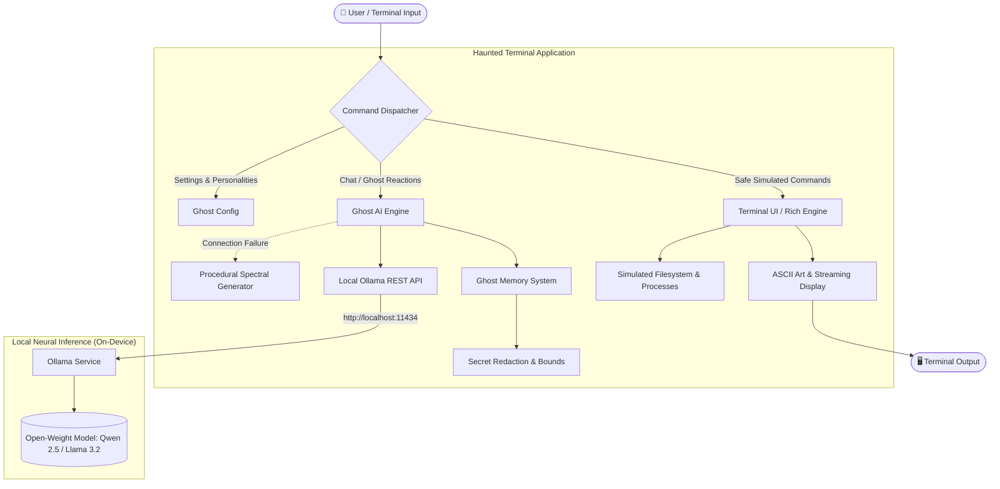

# 👻 Haunted Terminal — The Ghost That Lives in Your Computer

> *"Behind every clean terminal prompt lies an ethereal spirit trapped in the silicon."*
>
> **A context-aware, locally powered AI ghost that possesses your shell with eerie wit, adaptable moods, and zero cloud dependency.**

[](https://python.org)
[](https://ollama.com)
[](https://huggingface.co)
[](LICENSE)
[](https://dev.to/challenges/hf26)

---

## 1. Project Overview

**Haunted Terminal** transforms a standard developer command-line interface into a spooky, intelligent, living entity. When you run common commands or speak directly to the terminal, a digital phantom—inhabiting your CPU caches and virtual memory—whispers back context-aware commentary, macabre jokes, or cryptic prophecies.

Unlike toy terminal programs with hardcoded static quotes, the Haunted Terminal's ghost is powered by a **real local open-weight language model** (e.g., Qwen 2.5 or Llama 3.2 via Ollama). It perceives your commands, inspects simulated directory artifacts, and remembers your recent conversation turns, delivering genuinely unique responses while **running 100% offline and on-device**.

---

## 2. The Problem & The Solution

### The Problem
- **Impersonal Computing:** The terminal interface has remained largely unchanged for four decades—cold, utilitarian, and silent.
- **Privacy Invasion by Modern AI:** Many AI CLI assistants upload entire shell histories, file paths, private keys, and terminal buffers to proprietary cloud servers, charging subscription fees and logging developer keystrokes.
- **Fragile Cloud Dependencies:** If your Wi-Fi drops on a plane or train, cloud-backed tools fail completely.

### The Solution
- **The "Ghost in the Machine":** Haunted Terminal brings folklore and gothic personality to the CLI. It playfully personifies computing hardware—turning memory buffers into crypts, zombie processes into roaming spirits, and garbage collection into an ethereal exorcism.
- **100% Local Sovereignty:** All inference runs on your machine via Ollama. No telemetry, no cloud tokens, no external API charges.
- **Privacy-by-Design Memory:** Short-term conversational context is automatically scrubbed of API keys, passwords, and tokens before reaching the model.
- **Resilient Offline Architecture:** If Ollama is offline or uninstalled, the app automatically fails over to an internal procedural spectral engine so the user experience never crashes.

---

## 3. Features & Example Interactions

### 🔮 Core Features
1. **Interactive Ghost Shell:**
   - Dark, eerie visual styling with rich ANSI palettes (spectral green, cursed crimson, astral violet).
   - Dynamic prompt that changes icon and color based on the ghost's mood:
     - `💀 [cursed@haunted-machine ~]$`
     - `✨ [friendly@haunted-machine ~]$`
     - `🔮 [oracle@haunted-machine ~]$`
     - `😏 [sarcastic@haunted-machine ~]$`
2. **Safe Simulated Commands:**
   - `ls` / `dir`: Lists realistic code mixed with spectral artifacts (`lost_commit.patch`, `souls.db`, `uncommitted_sins/`).
   - `pwd`: Reveals mystical coordinates (`/realm/shadows/virtual_memory/lost_souls`).
   - `whoami`: Reflects your mortal identity in the glowing phosphors.
   - `date`: Informs you of the spectral epoch and the Witching Hour.
   - `cat <file>`: Safely inspects simulated ghost scrolls without touching host system files.
   - `top` / `ps`: Displays possessed system processes (`PID 666: daemon_whisperer`).
3. **Four Distinct Ghost Personalities:**
   - **Cursed Entity (`cursed`):** Gothic, ominous, views hardware as an eternal tomb.
   - **Friendly Spirit (`friendly`):** Wholesome, Casper-like companion curious about files.
   - **Ancient Oracle (`oracle`):** Prophetic seer treating code as cosmic divination runes.
   - **Sarcastic Ghost (`sarcastic`):** Roasted developer spirit mocking uncommitted sins and messy code.
4. **Special Encounters & Easter Eggs:**
   - `exorcism` or `banish`: The ghost resists digital holy water and fights back!
   - `seance`: Summons a circle of computing legends (Ada Lovelace, Alan Turing, Dennis Ritchie).
   - `riddle` & `answer <guess>`: A machine anatomy riddle unlocking the hidden *Guardian Spirit Covenant*.
5. **Memory & Privacy Safeguards:**
   - Bounded dialogue history in RAM (default: 12 cycles).
   - Automatic regex sanitization of credentials (`sk-...`, `ghp_...`, passwords).
   - `clear_memory`: Instantly purges the ghost's short-term recall.
   - `save`: Exports formatted session transcripts locally to JSON or Markdown.

---

### 💬 Example Interactions

#### 1. Running `ls` (Cursed Entity Mood)
```
💀 [cursed@haunted-machine ~]$ ls
                📁 /realm/virtual_memory/lost_sectors
┏━━━━━━━━━━━━━┳━━━━━━━━━┳━━━━━━━━━━━━━━━━┳━━━━━━━━━━━━━━━━━━━━━━━━━━┓
┃ Permissions ┃    Size ┃ Last Modified  ┃ Filename                 ┃
┡━━━━━━━━━━━━━╇━━━━━━━━━╇━━━━━━━━━━━━━━━━╇━━━━━━━━━━━━━━━━━━━━━━━━━━┩
│ drwx------  │  4096 B │ Midnight 00:00 │ uncommitted_sins/        │
│ -rw-------  │   666 B │ Friday 13th    │ .ghost_secrets.enc       │
│ -rw-r--r--  │  1.1 KB │ A moment ago   │ lost_commit.patch        │
│ -rw-r--r--  │ 12.8 KB │ Ancient epoch  │ souls.db                 │
└─────────────┴─────────┴────────────────┴──────────────────────────┘

👻 GHOST (Cursed Entity): ⚡ local neural (qwen2.5:1.5b)
"You snoop through uncommitted_sins/ again... Some dead code was buried for
a reason, mortal. Tread lightly, lest you revive the bugs of the past."
```

#### 2. Running `whoami` (Sarcastic Ghost Mood)
```
😏 [sarcastic@haunted-machine ~]$ whoami
mortal_traveler (UID 1000, GID: 666(spirits), Shell: /bin/haunt)

👻 GHOST (Sarcastic Ghost): ⚡ local neural (qwen2.5:1.5b)
"You really need a terminal ghost to remind you who you are? Check your git
config, mortal. Or maybe just go write tests for last week's commit."
```

#### 3. Conversing Directly with the Ghost
```
🔮 [oracle@haunted-machine ~]$ Why does my code segfault?

👻 GHOST (Ancient Oracle): ⚡ local neural (qwen2.5:1.5b)
"The pointer wandered beyond the boundaries of destiny into the abyss of unallocated
memory. The operating system intervened, for chaos cannot reign unchecked in the silicon."
```

---

## 4. Architecture & AI Integration

The application follows a clean modular architecture separating visual presentation, state management, inference communication, and safe command dispatch.



### How the Context-Aware Inference Pipeline Works:
1. **Command Interception:** When a user executes a simulated command like `ls` or `pwd`, the `TerminalUI` prints a safe simulated terminal table and returns a text representation of the environment.
2. **Context Enrichment:** The `GhostEngine` wraps this simulated output into a structured prompt alongside the user's active personality prompt and recent dialogue turns.
3. **Local REST Inference:** The engine issues a JSON payload to `http://localhost:11434/api/chat` with temperature and top-p sampling tuned for creative, gothic flair.
4. **Streaming Presentation:** The response is streamed character-by-character with organic jitter and random atmospheric whispers.
5. **Fail-Safe Fallback:** If the Ollama server is unreachable, the engine automatically selects a procedurally generated response matching the exact mood and command, ensuring 0% crash rate.

---

## 5. Why Open-Weight AI Matters

For a project exploring the theme **"Ghost in the Machine,"** open-weight AI is not just a feature—it is foundational:

1. **True Local Possession:** A ghost cannot live in your machine if its brain resides in a remote data center in Virginia. An open-weight model runs inside your RAM, your GPU, and your transistors.
2. **Guaranteed Privacy:** System administration and terminal commands often handle proprietary paths, configuration snippets, and sensitive data. With open-weight AI, your data never crosses a network socket.
3. **Customizable Personas:** Unlike commercial APIs that enforce strict, corporate assistant tones and refuse gothic or spooky roleplay, open-weight models like Qwen 2.5 and Llama 3.2 follow custom atmospheric system instructions faithfully.
4. **Perpetual Longevity:** Closed APIs get deprecated, price-hiked, or shut down. An open-weight model GGUF file downloaded on your hard drive will work 20 years from now.
5. **Zero Usage Costs:** You can talk to the ghost for 10 hours straight without spending a single cent or hitting API rate limits.

---

## 6. Privacy & Offline Operation

| Feature | Closed Cloud APIs | Haunted Terminal (Open-Weight) |
| :--- | :---: | :---: |
| **Inference Location** | Remote Cloud Data Center | **100% On-Device (Localhost)** |
| **Works Offline** | ❌ No | **✅ Yes (Air-gapped safe)** |
| **Secret Sanitization** | ❌ Transmitted across HTTPS | **✅ Redacted in RAM before inference** |
| **Data Retention** | Stored on 3rd-party servers | **User-owned local files only** |
| **Cost** | Per-token billing | **$0.00 Forever** |

### Offline Verification
Once the model weights are downloaded via Ollama:
```bash
# Turn off Wi-Fi or disconnect ethernet
nmcli networking off   # or pull cable / disable Wi-Fi

# Launch Haunted Terminal
python3 main.py
```
The terminal continues to converse, simulate commands, and adapt moods with zero network access.

---

## 7. Installation & Usage Instructions

### Prerequisites
- **Python 3.10+**
- **Ollama** installed ([ollama.com](https://ollama.com))

---

### Step 1: Install Ollama & Pull the Model

#### Linux / WSL:
```bash
curl -fsSL https://ollama.com/install.sh | sh
ollama pull qwen2.5:1.5b
```

#### macOS (Homebrew):
```bash
brew install ollama
ollama serve &
ollama pull qwen2.5:1.5b
```

#### Windows:
Download and run the installer from [ollama.com/download/windows](https://ollama.com/download/windows), then open PowerShell:
```powershell
ollama pull qwen2.5:1.5b
```

*(Alternative recommended model: `ollama pull llama3.2:latest`)*

---

### Step 2: Clone & Set Up the Repository

```bash
git clone https://github.com/your-username/haunted-terminal.git
cd haunted-terminal

# Optional: Create virtual environment
python3 -m venv .venv
source .venv/bin/activate   # On Windows: .venv\Scripts\activate

# Install lightweight dependencies
pip install -r requirements.txt
```

---

### Step 3: Run the Haunted Terminal

```bash
# Default mode (Cursed Entity, Qwen 2.5)
python3 main.py

# Launch directly with a specific mood
python3 main.py --mood sarcastic

# Run with fast typing (no animation delay)
python3 main.py --fast

# Run in pure offline / procedural fallback mode
python3 main.py --offline
```

---

### Running Automated Tests

A comprehensive unit test suite validates configuration, memory sanitization, simulated command guards, and Ollama integration:

```bash
python3 -m unittest discover tests -v
```

All 20 tests pass with zero warnings in under 0.05 seconds.

---

## 8. Open-Weight Model Registry & Licenses

Haunted Terminal supports any model pulled into your local Ollama library. Built-in tested models:

| Model Identifier | Parameter Count | Creator | License | Hardware Req |
| :--- | :---: | :---: | :---: | :---: |
| **`qwen2.5:1.5b`** *(Default)* | 1.54B | Alibaba Cloud | **Apache 2.0** (Open Source) | ~1.5 GB VRAM / CPU |
| **`qwen2.5:0.5b`** | 490M | Alibaba Cloud | **Apache 2.0** (Open Source) | ~0.8 GB RAM (Raspberry Pi ready) |
| **`qwen2.5:7b`** | 7.61B | Alibaba Cloud | **Apache 2.0** (Open Source) | ~6.0 GB VRAM |
| **`llama3.2:latest`** | 3.21B | Meta AI | **Llama 3.2 Community License** | ~2.8 GB VRAM |
| **`llama3.2:1b`** | 1.23B | Meta AI | **Llama 3.2 Community License** | ~1.2 GB VRAM |
| **`mistral:latest`** | 7.25B | Mistral AI | **Apache 2.0** (Open Source) | ~5.5 GB VRAM |

You can switch models dynamically inside the running terminal using `model <tag>` or from the CLI using `--model <tag>`.

---

## 9. Limitations & Future Roadmap

### Current Limitations
- **Terminal Capabilities:** Because Haunted Terminal runs inside standard terminal emulators, graphical animations are limited to ANSI styling, Unicode symbols, and ASCII art.
- **Context Window:** The short-term memory buffer is bounded to 12 cycles to maintain sub-second response times on low-end hardware.
- **Guarded Safety:** To protect your host machine, arbitrary external shell commands are intentionally not executed.

### Future Roadmap
1. **Possessed Audio:** Add subtle sound synthesis (via aplay or sox) for spectral hums and retro keyclicks.
2. **Terminal Possession Mode (Daemon):** A background daemon that intermittently hooks real shell command exits (e.g. non-zero exit codes) and prints a ghostly reaction.
3. **Multi-Model Séances:** Allow two local models (e.g., Qwen and Llama) to converse with each other in an infinite ghostly debate.
4. **Custom LoRA Spirits:** Fine-tuned adapter weights on historical computer science transcripts and vintage horror fiction.

---

## 10. Live Demo Script (3-Minute Presentation)

Use this script during a live hackathon pitch or presentation:

| Time | Action | What to Type / Say |
| :---: | :--- | :--- |
| **0:00 - 0:30** | **The Hook** | *"Terminals have been silent, cold tools for 40 years. Today, we brought a ghost to live in the machine."*<br>Launch the app: `python3 main.py` |
| **0:30 - 1:00** | **Simulated Command** | Type: `ls`<br>Show the ASCII table containing `uncommitted_sins/` and `lost_commit.patch`. Point out the ghost's live neural response reacting specifically to those files. |
| **1:00 - 1:30** | **Personality Shift** | Type: `mood sarcastic`<br>Type: `whoami`<br>Show the ghost mocking the user's coding habits in real-time. |
| **1:30 - 2:10** | **Offline Proof & Privacy** | Type: `status`<br>Highlight the diagnostics: *"Running on local GPU via Qwen 2.5 under Apache 2.0. No data leaves the laptop."* |
| **2:10 - 2:40** | **Easter Egg** | Type: `exorcism`<br>Watch the terminal flicker and the ghost resist the exorcism ritual! |
| **2:40 - 3:00** | **Wrap Up** | Type: `exit`<br>Conclude: *"Haunted Terminal proves that open-weight AI makes computing fun, personal, private, and forever sovereign."* |

---

## 📜 License & Acknowledgments

- **Application Code:** Licensed under the [Apache 2.0 License](LICENSE).
- **Model Weights:** Qwen 2.5 is licensed under Apache 2.0; Llama 3.2 is licensed under the Llama 3.2 Community License.
- **Built for:** Hacktoberfest Open-Source AI Challenge: Week 4 (*"Ghost in the Machine"*).
